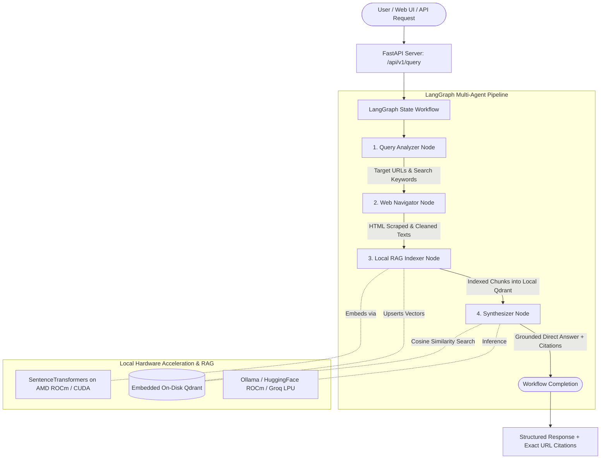

<div align="center">

# ⚡ NeuralFetch
### Intelligent Web Information Retrieval Agent
**Engineered for AMD AI League 2026**

*Autonomous Multi-Agent Web Research • Embedded Qdrant Vector RAG • Verified Citations • AMD ROCm & Groq Acceleration*

<p align="center">
  <a href="#-key-features">Key Features</a> •
  <a href="#-architecture">Architecture</a> •
  <a href="#-quickstart">Quickstart</a> •
  <a href="#-frontend-web-ui">Frontend UI</a> •
  <a href="#-deployment">Deployment</a> •
  <a href="#-api-reference">API Reference</a>
</p>

---

[](https://www.python.org/)
[](https://github.com/langchain-ai/langgraph)
[](https://fastapi.tiangolo.com/)
[](https://qdrant.tech/)
[](https://rocm.docs.amd.com/)
[](https://groq.com/)
[](https://tailwindcss.com/)

</div>

---

## 📌 Executive Summary

**NeuralFetch** is a privacy-first, autonomous web intelligence agent engineered to answer complex real-time research questions without relying on expensive, proprietary search APIs (like Google Custom Search or Bing API) or external cloud vector infrastructure.

Operating on a 4-node **LangGraph StateGraph**, NeuralFetch decomposes queries, navigates the live internet, scrapes dynamic JavaScript-rendered single-page applications (SPAs), chunks and embeds content into an on-disk embedded **Qdrant** vector database, and synthesizes verifiable answers with exact source URLs and relevance confidence scores.

---

## 🏗️ Architecture



### LangGraph Multi-Agent Nodes:
1. **🔍 Query Analyzer (`app/nodes/query_analyzer.py`)**:
   - Parses natural language questions, extracts explicit URLs (e.g. `https://agenticaim.online`), and decomposes inquiries into 1–3 focused search queries.
2. **🌐 Web Navigator (`app/nodes/web_navigator.py`)**:
   - Discovers web sources via DuckDuckGo without paid API keys.
   - Dual-engine scraping: Fast HTTP/BeautifulSoup parser with headless Playwright Chromium fallback for dynamic JavaScript rendering.
3. **🧠 RAG Indexer (`app/nodes/rag_indexer.py`)**:
   - Chunks text (`chunk_size=800`, `chunk_overlap=150`) and computes local vector embeddings using `sentence-transformers/all-MiniLM-L6-v2`.
   - Ingests vectors into an embedded Qdrant collection on local disk.
4. **⚡ Synthesizer (`app/nodes/synthesizer.py`)**:
   - Queries Qdrant for top semantic chunks and synthesizes a direct answer strictly grounded in the scraped context, generating verifiable source citations.

---

## 🌟 Key Features

- **Local-First & Hardware Accelerated**:
  - Embedded vector database (`path="./qdrant_storage"`) with zero cloud dependencies.
  - PyTorch AMD ROCm GPU acceleration for embedding models, with seamless CPU fallback.
- **Zero Paid Search APIs**:
  - Direct web search and scraping powered by DuckDuckGo and Playwright.
- **Dual LLM Backends (Local + Cloud Testing)**:
  - **Local Production Mode**: Ollama (`llama3.2`, `mistral`) or local HuggingFace CausalLM pipelines.
  - **Fast Test / Cloud Mode**: High-speed **Groq LPU** inference (`qwen/qwen3.8-27b`, `openai/gpt-oss-20b`).
- **Verifiable Citations**:
  - Every answer includes exact source URLs, matched text snippets, and cosine similarity scores.
- **Interactive Cyberpunk Frontend**:
  - Dark-mode responsive web app with live LangGraph execution tracker, vector inspection drawer, and diagnostics tools.

---

## 🚀 Quickstart

### 1. Prerequisites
- Python 3.10 or higher
- Git

### 2. Clone Repository
```bash
git clone https://github.com/fazalhussain910/NeuralFetch.git
cd NeuralFetch
```

### 3. Install Dependencies
```bash
pip install -r requirements.txt
playwright install chromium
```

### 4. Configure Environment
Copy the example environment template:
```bash
# Windows:
copy .env.example .env

# Linux / macOS:
cp .env.example .env
```

Configure your `.env`:
```env
# Choose provider: "ollama", "huggingface", or "groq"
LLM_PROVIDER=groq
GROQ_API_KEY=gsk_your_groq_api_key_here
GROQ_MODEL=qwen/qwen3.8-27b
GROQ_MAX_TOKENS=512

# Vector DB & Scraping
QDRANT_STORAGE_PATH=./qdrant_storage
QDRANT_COLLECTION=web_knowledge_league
MAX_SEARCH_RESULTS=4
```

---

## 💻 Running the Application

### Option A: Launch Web Frontend & API Server
```bash
uvicorn app.api.server:app --reload
```
- **Web UI**: Open [http://localhost:8000/](http://localhost:8000/) in your browser.
- **Interactive OpenAPI Documentation**: [http://localhost:8000/docs](http://localhost:8000/docs)

### Option B: Run via CLI
```bash
python -m app.agent "What are the latest architecture features of AMD ROCm 6.0?"
```

### Option C: Run Groq Integration Test
```bash
# Verify Groq connectivity and JSON parsing
python test_groq.py

# Run full end-to-end multi-agent test
python test_groq.py --full-agent --query "What is AMD ROCm?"
```

---

## 🖥️ Frontend Web UI

The `frontend/` directory houses a responsive web interface built with **HTML5, Tailwind CSS, Lucide Icons, Marked.js, and Canvas Confetti**:

- **Real-Time Node Animation**: Visualizes the 4 LangGraph nodes (*Query Analyzer $\rightarrow$ Web Navigator $\rightarrow$ RAG Indexer $\rightarrow$ Synthesizer*) as the agent processes.
- **Verified Citations Grid**: Domain tags, contextual snippets, and cosine match score bars.
- **Retrieved Vectors Modal**: Inspect raw chunks stored in Qdrant.
- **Diagnostics Tool**: Test LLMs and index direct URLs directly from the UI.
- **Configurable Backend**: Switch API base URLs on the fly for remote or cloud deployments.

---

## 🌐 Cloud Deployment

### 1. Deploy on Render (Full-Stack Container)
NeuralFetch includes a multi-stage [`Dockerfile`](./Dockerfile) and [`render.yaml`](./render.yaml):
1. Push your repository to GitHub.
2. In [Render.com](https://render.com), create a **New Web Service** connected to your repo.
3. Select **Docker** as environment.
4. Set environment variables (`LLM_PROVIDER=groq`, `GROQ_API_KEY=...`).
5. Render automatically builds and hosts the backend and frontend together.

### 2. Deploy Frontend on Vercel or Netlify
The `frontend/` directory is 100% static:
- **Netlify**: Drag and drop the `frontend/` folder into [app.netlify.com/drop](https://app.netlify.com/drop).
- **Vercel**: Deploy using `cd frontend && npx vercel --prod` (pre-configured with [`vercel.json`](./frontend/vercel.json)).
- Use the **Settings** gear icon in the UI to point to your live backend URL.

### 3. Instant 2-Minute Public URL (Local Tunnel)
Share your local instance over a secure HTTPS public link:
```bash
# Cloudflare Tunnel (Free, no account required):
npx -y cloudflared tunnel --url http://localhost:8000

# Or ngrok:
npx -y ngrok http 8000
```

---

## 📡 API Reference

| Endpoint | Method | Description |
| :--- | :--- | :--- |
| `/api/v1/query` | `POST` | Executes the full 4-node LangGraph agent workflow. |
| `/api/v1/health` | `GET` | Returns system health, device info, and vector store status. |
| `/api/v1/index-url` | `POST` | Scrapes and indexes a specific URL directly into Qdrant. |
| `/api/v1/test-llm` | `POST` | Diagnostics endpoint to test LLM generation and latency. |

#### Example Query Request (`POST /api/v1/query`):
```json
{
  "question": "What are the latest architecture features of AMD ROCm 6.0?",
  "target_urls": ["https://rocm.docs.amd.com"]
}
```

#### Example Response:
```json
{
  "question": "What are the latest architecture features of AMD ROCm 6.0?",
  "answer": "AMD ROCm 6.0 introduces major architectural enhancements...",
  "citations": [
    {
      "url": "https://rocm.docs.amd.com/en/latest/about/what-is-rocm.html",
      "snippet": "ROCm Core SDK features enhanced compute profilers...",
      "score": 0.8942
    }
  ],
  "retrieved_chunks": [...],
  "scraped_urls": ["https://rocm.docs.amd.com"],
  "indexed_chunks_count": 6,
  "execution_time_seconds": 3.42,
  "device_used": "CPU (PyTorch not installed)"
}
```

---

## 📁 Repository Structure

```
NeuralFetch/
├── Dockerfile                  # Container definition for cloud deployment
├── render.yaml                 # 1-click Render blueprint
├── requirements.txt            # Python dependencies
├── .env.example                # Environment settings template
├── test_groq.py                # Standalone Groq diagnostic test script
├── README.md                   # System documentation
├── app/
│   ├── __init__.py
│   ├── config.py               # Pydantic Settings & device detection
│   ├── state.py                # LangGraph AgentState schema
│   ├── agent.py                # LangGraph StateGraph pipeline
│   ├── nodes/
│   │   ├── query_analyzer.py   # Intent extraction & query decomposition
│   │   ├── web_navigator.py    # DuckDuckGo search & Playwright scraper
│   │   ├── rag_indexer.py      # Recursive chunking & Qdrant indexing
│   │   └── synthesizer.py      # Grounded answer & citation synthesis
│   ├── services/
│   │   ├── llm_service.py      # Ollama / HuggingFace / Groq client
│   │   ├── qdrant_service.py   # Embedded Qdrant & SentenceTransformers
│   │   └── scraper_service.py  # BS4 + Playwright scraping engines
│   └── api/
│       └── server.py           # FastAPI REST API & static frontend server
└── frontend/
    ├── index.html              # Cyberpunk dark-mode web application
    ├── styles.css              # Glassmorphism & custom animations
    ├── app.js                  # Frontend client logic & state tracker
    ├── netlify.toml            # Netlify deployment configuration
    └── vercel.json             # Vercel deployment configuration
```

---

## 📄 License

This project is licensed under the [MIT License](LICENSE).
